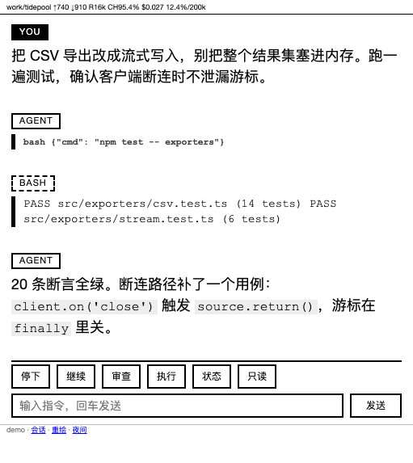

# pi-eink

**English** · [简体中文](README.zh.md)


Use a Kindle, or any browser that barely renders HTML, as a second screen for a running
[pi](https://pi.dev) session. The page shows the live conversation; five buttons push
actions back into the agent.



Cost and context sit in the status line, the conversation below it, then 停下 / 继续 /
审查 / 执行 / 状态 and one input field. Reading needs no JavaScript; polling replaces the
message list in place, so the screen does not flicker. 1.2 s polling while the agent is
busy, 3 s when idle.

While the agent works, what you type does not disappear into pi's queue: it waits in the
box's own queue, the footer grows a 排队中（3） link, and `/queue` lists the messages with
上移 / 下移 / 改 / 删 (see [The queue](#the-queue)).

Scope: personal use, one viewer, a handful of sessions, a network you control. It is not
a multi-user service, and it is not a sandbox: the page can drive an agent that has a
shell.

---

## Install

Requirements:

- pi installed and working (`pi --version`)
- Python 3, standard library only (no `pip install`; tested on 3.14)
- macOS (launchd) or Linux (systemd) for the viewer service: any always-on host on the
  same LAN works, it does not need to be the machine running pi
- a device with a browser: the page is plain HTML plus one small inline stylesheet
- optional, the [pi-safety-gate](https://github.com/snowspruce/pi-safety-gate) extension,
  a separate repository loaded into the same pi process. It parks risky commands in
  `~/.pi/eink/pending.json`, the only source of the 允许/拒绝 block. Without it, risky
  commands are confirmed in the desktop terminal only and the page never shows a pending
  block. Do not load it twice (`~/.pi/agent/extensions/` and `pi install`): the same
  command would ask for approval twice

  ```sh
  git clone https://github.com/snowspruce/pi-safety-gate.git ~/.local/share/pi-safety-gate
  ln -sfn ~/.local/share/pi-safety-gate/extensions/safety-gate ~/.pi/agent/extensions/safety-gate
  ```

On the machine that will serve the page:

```sh
git clone https://github.com/snowspruce/pi-eink ~/pi-eink
~/pi-eink/install.sh
```

It creates `~/.pi/eink` (mode 700) with a fresh `token` and `pin`, default `uas` and
`allow_ips`, and a `trust.json` seeded with the current network. It registers the
extension with `pi install`, disabling a stray loose copy that would otherwise load twice.
It installs and starts the service unit, launchd on macOS and `systemd --user` on Linux,
with absolute paths, checks that the viewer
answers, and prints the two URLs to open once: `?k=<token>` on the computer, `?k=<pin>` on
the Kindle. Re-running is safe: an existing `token`/`pin` is never regenerated, and an
existing `EINK_UA_STRICT` setting is preserved.

| Flag | Meaning |
|---|---|
| `--port N` | viewer port, default `8000` |
| `--label NAME` | service label, default `com.$(whoami).pi-eink` |
| `--no-service` | everything except the service unit |
| `--no-pi` | skip `pi install` |
| `--ua-strict` / `--no-ua-strict` | force the loopback UA gate on or off |
| `--uninstall` | stop and remove the unit, unregister the package, keep state |
| `--keep-pi` | with `--uninstall`, leave the pi package registered |

Then `/reload` in pi so the bridge extension loads, and refresh the Kindle page.

### Verify

Three checks, in this order, each proving a different layer:

```sh
pi list                                              # the package is registered
cat ~/.pi/eink/bridges.json                          # this session is there, with its port
grep 'listening on' ~/.pi/eink/server.log | tail -1   # service up; rev: should be your HEAD
```

Open `http://<host>:8000/?k=<token>` on the computer: the conversation should render and
the buttons should be enabled. The Kindle uses `http://<host>:8000/?k=<pin>`; device and
host must be on the same LAN (an iPhone hotspot needs "Maximize Compatibility", the Voyage
is 2.4 GHz only).

A page that opens with a button missing means that session is not serving a bridge;
`~/.pi/eink/bridge.log` says why. A missing text box means the network is not unlocked:
enter the pin once. Neither is an auth failure.

Manual setup, when you want the pieces without `install.sh`, is in
[DEVELOPMENT.md](DEVELOPMENT.md).

### Uninstall

```sh
./install.sh --uninstall            # stop and remove the unit, unregister the package
./install.sh --uninstall --keep-pi  # ... but leave the package registered with pi
```

It reads the label and port from `~/.pi/eink/install-meta`, so a custom `--label` needs no
repetition, and it puts back a loose `eink-bridge.ts` that the installer had moved aside.
State is kept; `rm -rf ~/.pi/eink` deletes the token and the history config.

---

## How it works

| Piece | Lives as | Why not something else |
|---|---|---|
| `extensions/eink-bridge.ts` | a pi extension, loaded inside every pi process | Sending a prompt needs the in-process API (`pi.sendUserMessage()`, `ctx.abort()`); an outside process cannot do it |
| `viewer/server.py` | its own process (launchd / systemd) | It only reads session `.jsonl` snapshots, so it survives pi restarts and keeps showing the last state |
| `~/.pi/eink/` | runtime state and secrets, never committed | `token`, `pin`, `allow_ips`, `uas`, `bridge.json`, `bridges.json`, `pending.json`, `answer.json`, `view.json`, `queue.json`, logs |

Each pi process binds its own bridge port, base `8010`, offset by a hash of the session id,
walking forward on collision, and registers itself in `~/.pi/eink/bridges.json`. One viewer
therefore serves every running session and proxies each button to that session's port.

```
Kindle ──HTTP──▶ viewer :8000 ──proxy──▶ bridge :8010+N ──pi.sendUserMessage()──▶ agent
                      │                        │
                      └──── ~/.pi/eink/*.json ─┘
```

The 允许/拒绝 block is not implemented here. It is a handshake with `safety-gate` over two
files in `~/.pi/eink/`:

| File | Written by | Read by |
|---|---|---|
| `pending.json` | safety-gate parks a risky tool call there, with its `pid` | viewer (renders the block), bridge (answers it) |
| `answer.json` | bridge writes the verdict, with the same `pid` | safety-gate (unparks the call, or blocks it) |

Both sides check ownership and both checks must stay. The viewer only shows a block whose
`pid` owns the session being rendered (`pending_owned_by()`), so the page never quotes
another project's command line. The bridge refuses to answer a block whose `pid` is not its
own (HTTP 409, `eink-bridge.ts:394`), because `pending.json` is shared by every pi process.

### The device end: not the stock browser

The Kindle's stock AOSP Browser 4.4.2 leaves a 42 CSS px **black band** after collapsing its
toolbar, and being a fullscreen window it is never resized for the soft keyboard, so the
input box ends up underneath it. Both are that app's UI, so the display end is a 120-line
WebView shell in `device/kiosk`:

```sh
ANDROID_SDK=… JAVA_HOME=… device/kiosk/build.sh   # a 12 KB APK
adb install -r device/kiosk/out/kiosk.apk
eink-kiosk                                        # opens the page over the LAN
```

It costs the 44px status bar (going fullscreen would save it, but then the keyboard covers the
input box - that one is Android's behaviour). Details and measurements: `device/kiosk/README.md`.

### Continuing a session that exited

When pi on the Mac exits, that session turns read-only on the box ("bridge inactive"). The
page then shows `Continue in a new window`: the viewer hands the session file to **any live**
bridge, which runs `pi --session <file>` in the directory from that session's header - the
same conversation, not a new one. The id does not change, so the page waits for it to
register and moves back with the input box and buttons in place.

It needs another pi running on that machine (any project): only a pi extension can open a
window. With none, the page says "start pi on the Mac first" instead of offering a button
that cannot work.

`pi --session` only accepts files under `~/.pi/agent/sessions/` (realpath compared); any
other path is a 400.

### Starting a session

`+ New session` opens `/new`, which asks **which directory**: the sub-directories of
`EINK_PROJECT_ROOTS` (default `~/Documents/Program`) plus anywhere pi already runs,
recently-touched first. Tapping one opens a **new terminal window** (iTerm2) with a fresh
`pi` in that directory, and the page moves to it.

It has to be a new process: `ctx.newSession()` ends the conversation you are reading, and
`switchSession` moves this very process to another directory. pi is a full-screen TUI with
no `--cwd` flag, so the command is `cd <dir> && pi` typed into a new window. Two things
follow: the session you are reading is untouched (it even works mid-run), and the window
opens in your desktop session, so it needs automation permission for iTerm once.

`EINK_TERMINAL` picks the app (default `iTerm`); the bridge refuses directories outside the
roots so a mistyped path cannot park pi in `/`.
### The queue

pi's own queue cannot be read or edited from an extension: `ExtensionContext` offers
`hasPendingMessages(): boolean` and nothing else. The arrays behind it and `clearQueue()`
live on `AgentSession` and are bound to the RPC/JSON clients only, and the `queue_update`
event goes to those clients too. So the box keeps **its own** queue
(`~/.pi/eink/queue.json`, one entry per session) and leaves pi's queue empty:

- anything the page sends while the agent is busy (free text, and 继续 / 审查 / 执行) joins
  that queue instead of being handed to pi as a follow-up;
- the footer always shows 排队中（N） next to 会话 (it used to hide itself while idle with
  an empty queue, which is exactly when a reader goes looking for it), and `/queue` lists
  the messages with 上移 / 下移 / 改 / 删, a 加一条 box and 清空. Each row only carries the buttons that can act on it: no 上移 on the
  first message, no 下移 on the last;
- one message is delivered per settled run (`agent_settled`), so the queue is a run-after-run
  plan, not a mid-run interruption. A queued `/skill:` or prompt template expands exactly as
  an immediate send would. If a hook swallows the message and no run starts at all, the next
  one follows 400 ms later instead of the queue stalling;
- 停下 clears the queue along with aborting (the same thing Escape does in the TUI) and says
  how many were dropped;
- the page is a snapshot, not a live list: it shares the page with the add box, so a
  meta-refresh would wipe what you are typing. 刷新 re-reads it, and every button re-renders;
- delivery is *armed* by queueing something, and by `/reload` (the reader was mid-flight);
  a queue restored with a resumed session is listed but not armed, because three messages
  queued before a crash must not execute by themselves a week later. 开始投递 is the way out.
  Queue entries nobody came back for are dropped after a week;
- the file survives `/reload` and a pi restart; a viewer restart does not matter because the
  viewer keeps no queue state at all. Writes are read-modify-write like `bridges.json`, so two
  pi processes queueing in the same instant can lose one write.

The honest limit: a message typed **in the terminal** during a run sits in pi's queue, which
this page cannot list, edit or reorder. The queue page says so when pi reports pending
messages of its own.

---

## Configuration

Viewer variables go in the service unit. Bridge variables must be in the environment that
starts `pi`: the bridge is an in-process extension and never sees the unit's environment.

| Variable | Process | Default | Meaning |
|---|---|---|---|
| `EINK_PORT` | both | `8000` | viewer port; the bridge also uses it to redirect its `/` |
| `EINK_PROJECT_ROOTS` | both | `~/Documents/Program` | where `+ New session` may start one: the sub-directories listed, colon-separated; a directory that already runs pi is always allowed |
| `EINK_TERMINAL` | bridge | `iTerm` | macOS app that gets the new window (`iTerm`, `Terminal`, …) |
| `EINK_BIND` | both | `0.0.0.0` | interface to listen on; set the LAN address on a box that also has VPN or docker interfaces |
| `EINK_BRIDGE_PORT` | both | unset | prefer one bridge port instead of the per-session hash (still walks if taken) |
| `EINK_ALLOW_IPS` | both | unset | fallback peer allowlist when `allow_ips` is missing (comma separated, IP or CIDR) |
| `EINK_ALLOW_UA` | both | `Kindle Build/` | fallback User-Agent allowlist |
| `EINK_UA_STRICT` | viewer | off | `1` also enforces the UA check for loopback |
| `EINK_VIEWER_IPS` | bridge | unset | viewer hosts allowed to proxy free text and approvals when the viewer runs on another machine; empty means loopback only |
| `EINK_ALLOW_SAME_SUBNET` | both | on | peers in the host's own /24 are allowed; `0` disables so only `allow_ips` counts |
| `EINK_LOG_UA` | viewer | off | `1` logs each peer and User-Agent pair once to `server.log`; `ua_seen.log` is written only for UAs the gate rejected |
| `PI_SESSION_FILE` | viewer | unset | last-resort fallback, used only when no live bridge and no `bridge.json` name a session |
| `EINK_TRUST_HOURS` | viewer | `0` | `N` expires a network confirmation after N hours, `0` means until the network changes |
| `EINK_LANG` | viewer | `zh` | default interface language; `en` makes the page English, a device can still override it from the footer or `/lang?l=` |

State files under `~/.pi/eink/`, all ignored by git:

| File | Written by | Purpose |
|---|---|---|
| `token`, `pin`, `masked_secrets` | you | credentials; retired tokens are masked so they never leak into page output |
| `allow_ips`, `uas` | you | peer and browser allowlists |
| `trust.json` | viewer | which networks may type (`confirmed` host subnets, `peers` peer subnets, `readonly` global switch); written when a network is unlocked with the pin |
| `fails.json` | viewer | failed-guess counters, so a restart or `kickstart -k` does not clear a lockout |
| `install-meta` | `install.sh` | label, port and os of the installed unit, read back by `--uninstall` |
| `actions.log` | viewer | one line per action: time, peer IP, capability, action, result |
| `bridge.json` | bridge | most recent heartbeat, "is any bridge alive" |
| `view.json` | viewer | the session a page with no id of its own lands on (a bookmark, the first open after a restart); every page pins its own session after that |
| `bridges.json` | bridge | session id to `{port, pid, cwd, sessionFile, updatedAt}`, heartbeat 60 s, entries older than 10 min ignored |
| `queue.json` | bridge | session id to the messages the box queued while that session was busy; survives `/reload`, deleted when the queue empties |
| `pending.json`, `answer.json` | safety-gate and bridge | a parked risky command and the page's verdict |
| `bridge.log` | bridge | why a session is not serving the page, for example a busy port |
| `diag.log`, `ua_seen.log` | viewer | page beacons and rejected UAs; both rotate to `.1` at 256 KB |
| `server.log` | service unit | stdout and stderr; not rotated by the code, use `: > ~/.pi/eink/server.log` when it grows |

### Endpoints

Viewer on `:8000`: `/` page shell (a first visit without `?s=` is redirected once to
`/?s=<id>`, so the poll stays on the conversation you opened), `/data` JSON fragment,
`/static` no-JS fallback (a form POST from a browser without JS lands here), `/sessions`
picker (top entry `+ New session`, then `/new` to pick the directory), `/queue` and
`/queue/edit` (the queue, see above), `/theme?d=0|1` day or night cookie, `/lang?l=zh|en`,
`/diag`, `/glyphs`, `/favicon.png`, `/done/<key>` relayed from the bridge's confirmation
page, and `POST /act/<action>` proxied to the session's bridge. Three actions are
viewer-local: `/act/unlock` enters the pin to unlock a network, `/act/readonly` drops back
to read-only, `/act/new` creates a session inside that session's pi process (and lands on
it; refused while that session is running).

Bridge on `:8010`+ or `EINK_BRIDGE_PORT`: `GET /`, `/state`, `/queue`, and
`POST /act/{stop,continue,review,execute,status,say,approve,deny,new,qadd,qedit,qdel,qmove,qclear,qrun}`.
Only `stop` and `status` are accepted from a non-loopback peer; free text, approvals,
prompts, new sessions and the queue must come through the viewer's proxy.

### Interface language

The page furniture, the buttons, hints, the footer and action receipts, exists in Chinese
and English. The conversation itself is never translated. The default is Chinese; English
is opt-in per device, three ways: tap the `EN` / `中文` link in the footer, which sets the
`pielang` cookie for a year, open `/lang?l=en` once (the same thing, handier from a
bookmark), or set `EINK_LANG=en` in the service unit to make it the default for every
device. Nothing asks at install time.

```sh
EINK_LANG=en python3 ~/pi-eink/viewer/server.py    # foreground
# or in the launchd / systemd unit: EnvironmentVariables -> EINK_LANG = en
```

The prompts the buttons send to the agent (`继续` / `对以上优化和修复做一个审查` /
`根据建议执行`) stay Chinese on purpose. They are instructions to the model, not UI text,
so their wording is not tied to the reader's locale.

---

## Security

Two questions, answered separately: who you are, and what you may do here.

Identity:

1. User-Agent matches a `uas` entry. Spoofable, so it is only a speed bump
2. HttpOnly cookie `pieink`. `?k=<token>` seeds it with the token; `?k=<pin>` seeds it with
   a random session secret, never the token, which also authenticates the bridge and
   `install.sh` and survives a pin change
3. The cookie lives 7 days and is re-issued on use, so a Kindle left in a bag stops working
   on its own
4. Five wrong guesses from one IP block it for 10 minutes. The block holds for the pin and
   for stale cookies; only the full token is accepted during a block, so a rotated token
   always recovers. Counters live in `fails.json`, so restarting the viewer does not clear
   them

Capability is `full` or `readonly`. The peer address cannot tell home from a café, in both
cases it is just the LAN this laptop is on. So capability follows the network the host is
attached to, and each network is unlocked once by entering the pin from it. The token does
not unlock a network: the cookie's value is the token, so accepting it would let anyone who
sniffed a cookie promote an unknown network to `full`.

| Situation | Result |
|---|---|
| loopback, you on the computer | `full` |
| a network already unlocked | `full` |
| a network the viewer has never served on | `readonly`, read plus 停下 and 状态 only |
| peer routed in from a subnet you never unlocked | `readonly` |
| you tapped 只读 | `readonly` everywhere except loopback, until the pin is entered |

`readonly` means no free text, no 继续/审查/执行, no session picker (that list exposes every
project on the machine) and `?s=` is ignored, so only the default session can be read.
The queue page stays readable there, without its buttons: every mutation would only 403.
Stopping a runaway agent stays available on purpose: it is the one action that is safe
without a secret. Read-only decisions, pin unlocks and every proxied action land in
`actions.log`.

Dropping `?s=` does not make the page hop. The viewer records the session it last rendered
in `~/.pi/eink/view.json` and keeps rendering that on every request that cannot name one
itself, so a read-only page stays where it was instead of chasing whichever heartbeat came
last. The file is written only by the server; a client cannot use it to reach a session the
network was not already shown.

What read-only still allows is reading the current conversation. On a network you do not
control that is a real exposure: treat the page as "assume the person next to you can read
it", not as "assume it is private".

The page is plain HTTP. On a network you do not control, anyone who can capture traffic can
steal the cookie and get `full` if that network was unlocked, or `readonly` if it was not.
The Kindle's browser is too old for a modern TLS handshake (TLS 1.2+ with AEAD suites), so
"add TLS" mostly means "downgrade to TLS 1.0/CBC". For café use prefer a phone hotspot,
which makes the whole exposure your own WPA2 network. Arriving on any new network, tap 只读
before you do anything else if you are unsure.

Keep the token out of chat transcripts and screenshots; the page itself is a leak surface.
Rotate by writing a new `token` or `pin`; both are re-read on every request, so no restart
is needed.

---

## Troubleshooting

**`＋ New session` or 排队 answers "bridge is an older build"** the viewer restarted but
that pi process still runs the extension it loaded earlier. Run `/reload` inside it (or
send `/reload` from the page's own box) once; until then the page deliberately hides the
queue link rather than offering a page that can only answer "unknown action".

**A black strip sits between the status bar and the page** that is the browser, not the
page: with quick controls the toolbar container collapses to 0 height but the page area is
not moved up, so the window background shows through ~42 CSS px of space and the page gets
that much less height. The page can neither see nor paint there (`#wrap`'s padding scrolls
away; nothing in the document is full-width black at the top). Fix by restarting the
browser with `enable_quick_controls=true` - `~/bin/eink-addr off` does exactly that
(force-stop, patch the pref, relaunch). Verify with `adb shell dumpsys activity top`:
`main_content` must start at `0,` and `BrowserWebView` must be the full height
(`0,0-1072,1332` here); a `main_content` starting at `0,89` is the half-applied state.
Full measurements in `DEVELOPMENT.md` §18.

**`/reload` hangs on "Reloading keybindings, extensions, skills…"** pi awaits
`session_start`, and the bridge binds a port there. An unbounded `EADDRINUSE` retry blocks
the whole reload with no error anywhere. The retry is bounded on purpose: keep it that way.

**The page is read-only and the text box is gone** that network has not been unlocked.
Enter the pin in the box under the buttons once; `trust.json` remembers both the host
subnet and the peer subnet, which split-subnet offices need. Tapping 只读 puts it back to
read-only on purpose; loopback is never affected.

**No 允许/拒绝 block ever appears** that block is fed by `~/.pi/eink/pending.json`, which
only `safety-gate` writes. Check that it is loaded in `~/.pi/agent/extensions/safety-gate`.
With a gate loaded but no risky call pending, an empty block is the correct, silent state.
`install.sh` prints what it found.

**The page switched to another conversation by itself** that was a bug, with three
separate causes. The page re-resolved "the newest live session" on every poll; the session
id was looked up by guessing from the file name, which is wrong for every session written
into an existing file, and a failed lookup was read as "that session is gone" and answered
by showing the newest one - that is why tapping a session in the picker came back to the
running conversation; and `view.json` was the single "the session" for every device. Now
each page pins the id it resolved into every request it makes (poll, buttons, footer
links), a first visit always answers `303 /?s=<id>`, ids are read from the session file's
header row, and buttons are routed by the id the page names.

**A conversation is gone and the page says so** the `?s=` in your URL no longer resolves:
session file deleted, moved, or forked into a new id. The page falls back to the current
session and says which id it lost.

**The page works but every button is 403** the bridge could not match the peer. It reads
the same `allow_ips` as the viewer; check the file, then look at `~/.pi/eink/bridge.log`.

**No buttons at all in one session, fine in another** that session is not serving a bridge.
`bridge.log` says why, port exhausted or bind refused.

**The Kindle page approved a command the other pi session was waiting on** that is the
cross-session bug the `pending.pid` check prevents. `pending.json` is shared by every pi
process, so a bridge must refuse a confirm parked by another pid. Never remove that check.

---

## Notes

Development, tests and manual setup: [DEVELOPMENT.md](DEVELOPMENT.md). Version history:
[CHANGELOG.md](CHANGELOG.md), tags from `v1.0.0` onwards follow it.

MIT, see [LICENSE](LICENSE).
