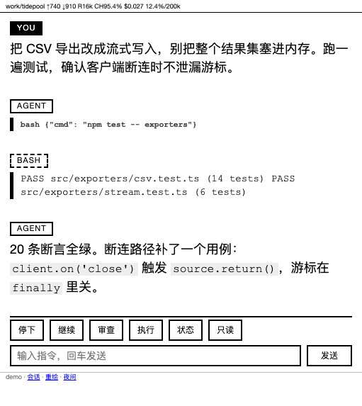

# pi-eink

[English](README.md) · **简体中文**

> 本文件与英文版 [README.md](README.md) 同步维护；两者不一致时以英文版为准。


把 Kindle——或者任何勉强能渲染 HTML 的浏览器——当作正在运行的 [pi](https://pi.dev)
会话的第二块屏。页面显示实时对话，五个白名单按钮把动作送回 agent。



上图是真机 511×573 的电子墨水屏：状态行里是花费与上下文占用，下面是对话，再往下是
停下 / 继续 / 审查 / 执行 / 状态 / 只读 和一个输入框。阅读不需要 JavaScript；轮询就地
替换消息列表，所以屏幕不会整页闪烁。

为同一局域网里的电子墨水设备而做：单栏、不需要 JavaScript、agent 干活时 1.2 秒轮询一次
（空闲时 3 秒）。

定位：个人自用——一个 viewer、几个会话、自己掌控的网络。它不是多用户服务，也不是沙箱：
这个页面能驱动一个带 shell 的 agent。

## 组成

| 部分 | 以什么形式存在 | 为什么不是别的方案 |
|---|---|---|
| `extensions/eink-bridge.ts` | 一个 pi 扩展（加载在每个 pi 进程内） | 发消息、中止都要进程内 API（`pi.sendUserMessage()`、`ctx.abort()`），外部进程做不到 |
| `viewer/server.py` | 独立进程（launchd / systemd） | 它只读会话 `.jsonl` 快照，所以 pi 重启或崩溃时还能显示最后状态 |
| `~/.pi/eink/` | 运行状态 + 密钥，**永不进仓库** | `token`、`pin`、`allow_ips`、`uas`、`bridge.json`、`bridges.json`、`pending.json`、`answer.json`、`view.json`、各类日志 |

每个 pi 进程绑定**自己的** bridge 端口（基址 `8010`，按会话 id 哈希偏移，冲突时向后走），
并把自己注册进 `~/.pi/eink/bridges.json`。于是一个 viewer 服务所有正在跑的会话，并把每个
按钮代理到该会话自己的端口。

```
Kindle ──HTTP──▶ viewer :8000 ──代理──▶ bridge :8010+N ──pi.sendUserMessage()──▶ agent
                      │                        │
                      └──── ~/.pi/eink/*.json ─┘
```

## safety-gate 契约

`允许/拒绝` 不在本仓库实现。它是与独立的
[pi-safety-gate](https://github.com/snowspruce/pi-safety-gate) 扩展之间的握手，通过
`~/.pi/eink/` 下的两个文件完成：

| 文件 | 谁写 | 谁读 |
|---|---|---|
| `pending.json` | safety-gate 把危险工具调用停在这里，**带上它的 `pid`** | viewer（渲染确认块）、bridge（应答） |
| `answer.json` | bridge 写回执，**带同一个 `pid`** | safety-gate（放行该调用，或拦截） |

两侧都要校验归属，两处检查都必须留着：

- viewer 只显示 `pid` 属于当前渲染会话的确认块（`pending_owned_by()`），页面因此不会
  引用另一个项目的命令行；
- bridge 拒绝应答 `pid` 不是自己的确认块（HTTP 409，`eink-bridge.ts:394`），因为
  `pending.json` 是所有 pi 进程共用的。

这就是全部契约——用 `pid` 停一辆车，等 `answer.json`。任何遵守它的东西都能免费获得
Kindle 端确认。

## 依赖

- pi 已装好可用（`pi --version`）
- [`safety-gate`](https://github.com/snowspruce/pi-safety-gate) 扩展，**独立仓库**，加载在
  同一个 pi 进程里：它把危险命令停在 `~/.pi/eink/pending.json`，那是 允许/拒绝 按钮的
  唯一数据源。可选——不装的话危险命令只在电脑终端确认，页面永远不会出现待确认块，也没有
  任何报错

  ```sh
  git clone https://github.com/snowspruce/pi-safety-gate.git ~/.local/share/pi-safety-gate
  ln -sfn ~/.local/share/pi-safety-gate/extensions/safety-gate ~/.pi/agent/extensions/safety-gate
  ```

  不要加载两次（`~/.pi/agent/extensions/` **和** `pi install` 同时用）：同一条命令会被问
  两遍。`install.sh` 会报告它有没有找到
- Python 3，只用标准库（不需要 `pip install`；在 3.14 上测过）
- macOS（launchd）或 Linux（systemd）来托管 viewer 服务——同一局域网里任何常开的主机都行，
  不必是跑 pi 的那台
- 一台有浏览器的设备：页面就是纯 HTML + 一小段内联样式

第一次接触的话，阅读顺序是：本 README 讲它是什么、怎么跑；然后
[DEVELOPMENT.md](DEVELOPMENT.md) 讲为什么长成这样，以及设备打不开页面时的排查阶梯。

## 安装

在将要提供页面的那台机器上（不必是跑 pi 的机器，只要是同一局域网里常开的东西）：

```sh
git clone https://github.com/snowspruce/pi-eink ~/pi-eink
~/pi-eink/install.sh
```

这一条命令做了下面手动步骤里的全部事情：

- 创建 `~/.pi/eink`（权限 700），生成新的 `token` 和 `pin`，默认的 `uas` 与
  `allow_ips`，并用你当前所在网络种好 `trust.json`
- 用 `pi install` 注册扩展（并把 `~/.pi/agent/extensions/` 里散落的副本挪开，否则会
  加载两次）
- 安装并启动服务单元——macOS 上是 launchd，Linux 上是 `systemd --user`——绝对路径和端口
  都填好
- 检查 viewer 有应答，然后打印两个只需打开一次的 URL：电脑上用 `?k=<token>`，Kindle 上
  用 `?k=<pin>`

重复运行是安全的：已有的 `token`/`pin` 永远不会重新生成（那会把所有设备踢下线），已有的
`EINK_UA_STRICT` 设置也会保留。

| 参数 | 含义 |
|---|---|
| `--port N` | viewer 端口（默认 `8000`） |
| `--label NAME` | 服务标签（默认 `com.$(whoami).pi-eink`） |
| `--no-service` | 除服务单元之外全都做 |
| `--no-pi` | 跳过 `pi install` |
| `--ua-strict` / `--no-ua-strict` | 强制开启/关闭 loopback 的 UA 门 |
| `--uninstall` | 停掉并移除服务单元、注销包，保留状态 |
| `--keep-pi` | 配合 `--uninstall`：保留 pi 里注册的包 |

装完之后：在 pi 里 `/reload` 让 bridge 扩展加载，然后刷新 Kindle 页面。

### 验证

三步，按顺序——每一步证明的是不同层：

```sh
pi list                                              # 包已注册
cat ~/.pi/eink/bridges.json                          # 本会话在里面，带自己的端口
grep 'listening on' ~/.pi/eink/server.log | tail -1   # 服务活着；rev: 应等于你的 HEAD
```

然后在电脑上打开 `http://<host>:8000/?k=<token>`：对话应该渲染出来，按钮应该是可用的。
Kindle 上用 `http://<host>:8000/?k=<pin>`——设备和主机必须在同一局域网（iPhone 热点需要
打开「最大兼容性」：Voyage 只支持 2.4 GHz）。

页面能打开但缺按钮，说明那个会话没有在提供 bridge，`~/.pi/eink/bridge.log` 会说明原因。
输入框消失说明该网络还没解锁——输一次 pin。这两种都不是鉴权失败；
[DEVELOPMENT.md](DEVELOPMENT.md) 里的排查阶梯第一步是先证明"请求到了没有"。

### 手动安装

```sh
mkdir -p ~/.pi/eink
openssl rand -hex 16 > ~/.pi/eink/token   # 长 token，脚本里也能用
chmod 600 ~/.pi/eink/token
```

在电子墨水设备上可选但强烈建议——敲 32 位 token 很痛苦，用一个短码代替：

```sh
printf '482913\n' > ~/.pi/eink/pin && chmod 600 ~/.pi/eink/pin   # 6 位数字
```

然后决定**哪些对端可以连这个服务**。没有这个文件时只允许 loopback，也就是你的 Kindle 会
拿到 HTTP 403：

```sh
cat > ~/.pi/eink/allow_ips <<'EOF'
# One IP or CIDR per line. "#" starts a comment. Loopback is always allowed.
127.0.0.1
::1
192.168.0.0/16
EOF
```

viewer 和 bridge 读的是同一个文件，所以两边对"谁能连"的判断永远一致（`EINK_ALLOW_IPS`
只在文件不存在时作为兜底）。

接着决定**你可以在哪里打字**：按你所在网络写 `~/.pi/eink/trust.json`，否则首次访问是只读，
直到输入 pin：

```json
{ "confirmed": ["192.168.1.0/24"], "peers": ["192.168.1.0/24"], "readonly": false }
```

`install.sh` 会用当前网络帮你种好这份文件。

#### 安装 pi 扩展

推荐做法——让 pi 从这个仓库管理它（本地来源是就地加载，不复制文件，所以 `git pull` 就是
更新方式）：

```sh
pi install ~/pi-eink          # 写进 ~/.pi/agent/settings.json
pi list                       # 应该列出 ~/pi-eink 及其解析后的路径
```

`pi install` 记录的是**相对于 settings 文件**的路径（`../../Documents/...` 那种形式），
这是正常的。不要在 `~/.pi/agent/extensions/` 里再放一份 `eink-bridge.ts`——两份都会加载，
一个会话会绑两个 bridge 端口，同一个按钮会被应答两次。

**本地目录还是 `git:` 来源？** 两种都能跑扩展，但只有本地 clone 才能同时托管 viewer 服务：
`git:github.com/you/pi-eink` 会被 clone 进 `~/.pi/agent/git/...`，那是 pi 自己拥有、更新时
会重写的树（`git reset --hard`、`git clean -fdx`、路径按 ref 索引）。把 launchd 或 systemd
指到那里，意味着下次 `pi update --extensions` 后服务就坏了。用一个你自己控制的 clone，让
`git pull` + 重启服务成为更新路径。

确认扩展活着：启动 pi，然后看 `~/.pi/eink/bridges.json`——正在跑的会话应该出现在里面，
带自己的端口。没有的话，`~/.pi/eink/bridge.log` 会说原因。

#### 运行 viewer

先在前台试一下：

```sh
EINK_PORT=8000 python3 ~/pi-eink/viewer/server.py
```

打开一次 `http://<host>:8000/?k=$(cat ~/.pi/eink/token)`——这会种下 `pieink` cookie，之后
直接访问 `http://<host>:8000/` 即可。Kindle 上可以用 `?k=<pin>` 代替那串长 token。

用 launchd 常驻（macOS）：把 `service/com.example.pi-eink.plist.example` 拷到
`~/Library/LaunchAgents/`，把里面的 `/path/to/pi-eink` 和 python 路径都替换掉，然后：

```sh
launchctl bootstrap "gui/$(id -u)" ~/Library/LaunchAgents/com.$(whoami).pi-eink.plist
```

Linux 上有 `service/pi-eink.service.example`（`systemctl --user enable --now pi-eink`）。
两种情况都一样：`git pull` **不会**重启 viewer——服务单元只保证进程活着，它不会重新加载
代码。更新之后：

```sh
launchctl kickstart -k "gui/$(id -u)/com.$(whoami).pi-eink"   # macOS，标签同 install.sh
systemctl --user restart pi-eink                          # Linux
```

电子墨水备注：主机休眠页面就黑了。第二个 launchd 单元里跑 `caffeinate -s`，可以在接电源时
让机器保持唤醒。

## 开发

扩展测试需要 Node 22+，viewer 需要 Python 3（只是跑页面的话两个都不需要）。

```sh
npm test                 # 扩展：stub 的 pi API、临时 HOME、真 HTTP 处理器
npm run test:viewer      # viewer：单元 + HTTP 级强制点（188 条，约 7 秒）
npm run test:cov         # 扩展覆盖率（node 内置报告器）
npm run test:cov:viewer  # viewer 覆盖率（需 `pip install coverage`）
```

两边都在 90% 行覆盖以上；具体数字看上面两个命令的输出，文档里不写死以免漂移。

测试绑定固定端口（`18019`），永不与真实 bridge 冲突，也从不碰 `~/.pi/eink`：HOME 指向临时
目录，并且会先清掉 `PI_SESSION_FILE`——pi 会导出这个变量，而它的优先级高于临时会话目录。
`test_http.py` 起一个真的 viewer 对着假 bridge，断言落在线上：只读对端即使请求进到处理器也
打不了字、动作落到页面显示的那个会话、请求无法选择该网络没被展示过的会话。`test_render.py`
覆盖那些不经过 socket 的部分：markdown → html、一行 → 一个消息块、确认块、bridge 注册表过滤
（pid 被复用时不能把死条目留在表里）和会话解析。`test_server.py` 测纯判据：按网络的能力、
UA、锁定、信任。

## 配置

环境变量。viewer 的变量写进服务单元；bridge 的变量必须在启动 `pi` 的那个环境里（bridge 是
进程内扩展，看不到服务单元的环境）：

| 变量 | 进程 | 默认 | 含义 |
|---|---|---|---|
| `EINK_PORT` | 两者 | `8000` | viewer 端口；bridge 也用它把自己的 `/` 重定向过去 |
| `EINK_BIND` | 两者 | `0.0.0.0` | 监听哪个网卡；机器上还有 VPN/docker 网卡时设成局域网地址 |
| `EINK_BRIDGE_PORT` | 两者 | 未设 | 强制指定一个 bridge 端口，而不是按会话哈希 |
| `EINK_ALLOW_IPS` | 两者 | 未设 | `allow_ips` 缺失时的兜底对端白名单（逗号分隔，IP 或 CIDR） |
| `EINK_ALLOW_UA` | 两者 | `Kindle Build/` | 兜底的 User-Agent 白名单 |
| `EINK_UA_STRICT` | viewer | 关 | `1` 时 loopback 也要过 UA 检查 |
| `EINK_VIEWER_IPS` | bridge | 未设 | viewer 跑在另一台机器时，允许代理自由文本/审批的 viewer 主机（逗号分隔）；空 = 只认 loopback |
| `EINK_ALLOW_SAME_SUBNET` | 两者 | 开 | 允许主机自己 /24 内的对端；`0` 关闭（那就只认 `allow_ips`）。viewer 和 bridge 都读，默认值相同 |
| `EINK_LOG_UA` | viewer | 关 | `1` 把每个 (对端, User-Agent) 组合记一次到 `server.log`；`ua_seen.log` 只记录被门挡掉的 UA |
| `PI_SESSION_FILE` | viewer | 未设 | 最后兜底：只在没有活着的 bridge、`bridge.json` 也没指名会话时使用 |
| `EINK_TRUST_HOURS` | viewer | `0` | `N` 小时后让网络确认过期（0 = 直到网络变化） |
| `EINK_LANG` | viewer | `zh` | 默认界面语言；`en` 让页面变英文。单台设备仍可用页脚链接或 `/lang?l=` 覆盖 |

`~/.pi/eink/` 下的状态文件（全部被 git 忽略）：

| 文件 | 谁写 | 用途 |
|---|---|---|
| `token`、`pin`、`masked_secrets` | 你 | 凭证（退役的 token 会被打码，所以不会漏进页面输出） |
| `allow_ips`、`uas` | 你 | 对端 / 浏览器白名单 |
| `trust.json` | viewer | 哪些网络可以打字（`confirmed` = 主机网段，`peers` = 对端网段，`readonly` = 全局开关）；在网络里用 pin 解锁时写入 |
| `fails.json` | viewer | 失败猜测计数，所以重启或 `kickstart -k` 不会清掉锁定 |
| `install-meta` | `install.sh` | 已安装单元的 label/port/os，`--uninstall` 时读回 |
| `actions.log` | viewer | 每个动作一行：时间、对端 IP、能力、动作、结果 |
| `bridge.json` | bridge | 最近一次心跳——"有没有 bridge 活着" |
| `view.json` | viewer | 页面最后渲染的会话；凡是请求自己报不出会话（`?s=`、只读网络）就重渲染它，于是页面不会在并行会话间跳 |
| `bridges.json` | bridge | 会话 id → `{port, pid, cwd, sessionFile, updatedAt}`，60 秒心跳，超过 10 分钟的条目忽略 |
| `pending.json`、`answer.json` | safety-gate ↔ bridge | 停放的命令与页面的裁决 |
| `bridge.log` | bridge | 某个会话为什么没在提供页面（端口被占等） |
| `diag.log`、`ua_seen.log` | viewer | 页面 beacon 与被拒 UA；都在 256 KB 时轮转到 `.1` |
| `server.log` | 服务单元 | stdout/stderr（POST 行、错误、traceback）；代码不轮转它——变大了就 `: > ~/.pi/eink/server.log` |

## 端点

Viewer（`:8000`）：`/` 页面外壳（首次访问若没有 `?s=`，会 303 一次到 `/?s=<id>`，轮询因此
停在你打开的那个会话上）· `/data` JSON 片段 · `/static` 无 JS 兜底页（没有 JS 的浏览器
表单 POST 会落到这里，因为 `/` 需要脚本填消息列表）· `/sessions` 会话选择器 ·
`/theme?d=0|1` 日间/夜间 cookie · `/lang?l=zh|en` 界面语言 cookie · `/diag` · `/glyphs` ·
`/favicon.png` · `/done/<key>`（转自 bridge 的确认页）· `POST /act/<action>` 代理到该会话的
bridge，另有两个 viewer 本地动作：`/act/unlock`（输入 pin 解锁本网络）和 `/act/readonly`
（切回只读）。

Bridge（`:8010` 起，或 `EINK_BRIDGE_PORT`）：`GET /`、`/state`、
`POST /act/{stop,continue,review,execute,status,say,approve,deny}`。非 loopback 对端只接受
`stop` 和 `status`：其余一切——自由文本、审批、提示词——必须经过 viewer 的代理。

## 界面语言

页面骨架——六个按钮、提示、页脚、动作回执——有中英两版。对话内容永远不翻译。

默认是**中文**。英文按设备 opt-in，三种方式：

- 点页脚的 `EN` / `中文` 链接——它设置一年期的 `pielang` cookie
- 打开一次 `/lang?l=en`（同样效果，存书签更方便）
- 在服务单元里设 `EINK_LANG=en`，让所有设备的默认变英文

```sh
EINK_LANG=en python3 ~/pi-eink/viewer/server.py    # 前台
# 或写进 launchd / systemd 单元：EnvironmentVariables -> EINK_LANG = en
```

安装时不问：默认值就是主人在用的那个，新设备继承它，直到有人点了页脚链接。

按钮发给 agent 的提示词（`继续` / `对以上优化和修复做一个审查` / `根据建议执行`）有意保持
中文——它们是指令而不是界面文字，措辞不该跟着读者的 locale 变。

## 安全模型

两个不同的问题，分开回答：**你是谁**（cookie）和**你在这能干什么**（网络）。

**身份**

1. User-Agent 命中 `uas` 里的某条——可伪造，所以它只是一道减速带
2. HttpOnly cookie `pieink` 等于 `token`；`?k=<token|pin>` 可以种下它
3. cookie 有效期 7 天，使用时续期，所以被塞进包里的 Kindle 会自己失效
4. 同一 IP 猜错五次锁定 10 分钟；计数存在 `fails.json`，所以重启 viewer 不会清掉

**能力**（`full` 或 `readonly`）

对端地址分不出家里和咖啡馆——两种情况都只是"这台笔记本所在的局域网"。所以能力跟着**主机**
接入的网络走，每个网络用它自己的 **pin** 解锁一次。token 不解锁网络：cookie 的值就是 token，
在这里接受它等于让任何嗅到 cookie 的人把未知网络提升成 `full`。

| 情形 | 结果 |
|---|---|
| loopback（你在电脑上） | `full` |
| 已解锁过的网络 | `full` |
| viewer 从未服务过的网络 | `readonly`：只能看 + 停下/状态 |
| 从你从未解锁的网段路由进来的对端 | `readonly` |
| 你点了 只读 | 除 loopback 外处处 `readonly`，直到输入 pin |

`readonly` 意味着：没有自由文本、没有 继续/审查/执行、没有会话选择器（那份列表会暴露这台
机器上的每个项目），并且 `?s=` 被忽略，所以只能读默认会话。停下失控的 agent 是有意保留的——
它是唯一不需要密钥也安全的动作。只读决策、pin 解锁和每一次被代理的动作都会落进
`actions.log`。

丢掉 `?s=` 不代表页面会跳：viewer 把自己最后渲染的会话记在 `~/.pi/eink/view.json`，凡是请求
自己报不出会话就重渲染它，于是只读页面待在原地，而不是去追最后心跳的那个 pi 会话。这个文件
只由服务端写——客户端无法借它访问该网络没被展示过的会话。

只读仍然允许读**当前**这段对话。在你不能控制的网络上，这是真实的暴露面：把页面当成
"假设旁边的人能看到"，而不是"假设它是私密的"。

**这套东西没解决的**

页面是纯 HTTP。在你不能控制的网络上，任何能抓流量的人都能偷走 cookie，如果那个网络解锁过
就是 `full`，没解锁就是 `readonly`。Kindle 的浏览器太老，握不了现代 TLS（TLS 1.2+ 带 AEAD
套件），所以"加上 TLS"多半等于"降级到 TLS 1.0/CBC"——在咖啡馆用优先选手机热点，那样整个
暴露面就是你自己的 WPA2 网络。到任何新网络，不确定就先点 只读 再动别的。

别让 token 进聊天记录和截图——页面本身就是泄露面。轮换方式是写新的 `token`/`pin`；两者每次
请求都重新读取，不需要重启。

## 排查

**`/reload` 卡在 "Reloading keybindings, extensions, skills…"** — pi 会 *await*
`session_start`，而 bridge 在那里绑端口。无上限的 `EADDRINUSE` 重试会卡住整个重载，且哪里
都不报错。重试有上限是有意的：别去掉。

**页面是只读，输入框不见了** — 那个网络还没解锁。在按钮下面那个框里输一次 pin
（`trust.json` 会同时记住主机网段和对端网段，分网段的办公室就靠这个）。点 只读 会故意切回
只读；loopback 永远不受影响。

**永远不出现 允许/拒绝 块** — 那个块由 `~/.pi/eink/pending.json` 提供，只有 `safety-gate`
扩展会写它（[pi-safety-gate](https://github.com/snowspruce/pi-safety-gate)）。确认它加载了
（`~/.pi/agent/extensions/safety-gate`）；gate 在、但没有危险调用待确认时，空块就是正确且
安静的状态。`install.sh` 会打印它找到没找到。

**页面自己换了会话** — 那是个 bug：没有 `?s=` 时页面每次轮询都重新解析"最新的活会话"，于是
另一个 pi 会话的心跳会把整页换掉。两处修复：首次访问把 `?s=` 固化进 URL；凡是报不出会话
（只读网络、书签里没有 `?s=`）就重渲染 `view.json` 里记的那个，而不是重新算"最新"。

**某个对话不见了，页面会提示** — URL 里的 `?s=` 解析不到了（会话文件被删、移走，或 fork 成
了新 id）。页面回落到当前会话，并说明丢的是哪个 id；可以到 /sessions 里再挑一个。

**页面能用但每个按钮都 403** — bridge 认不出这个对端。它读的是和 viewer 同一份
`allow_ips`；先看文件，再看 `~/.pi/eink/bridge.log`。

**某个会话完全没有按钮，另一个正常** — 那个会话没有在提供 bridge。`bridge.log` 会说原因
（端口耗尽、绑定被拒）。

**Kindle 页面批准了另一个 pi 会话在等的命令** — 那是 `pending.pid` 检查防的跨会话 bug：
`pending.json` 被所有 pi 进程共用，所以 bridge 必须拒绝应答别的 pid 停的车。永远别去掉这个
检查。

## 卸载

```sh
./install.sh --uninstall            # 停掉并移除单元、注销包
./install.sh --uninstall --keep-pi  # ……但保留 pi 里注册的包
```

它读 `~/.pi/eink/install-meta` 里记录的 label 和端口，所以自定义过 `--label` 也不用再写一遍；
它还会把安装器挪走的散落 `eink-bridge.ts` 放回原处。状态保留；`rm -rf ~/.pi/eink` 会删掉
token 和历史配置。没有别的要吊销——它从未离开过这台机器。

## 许可证

MIT——见 [LICENSE](LICENSE)。
